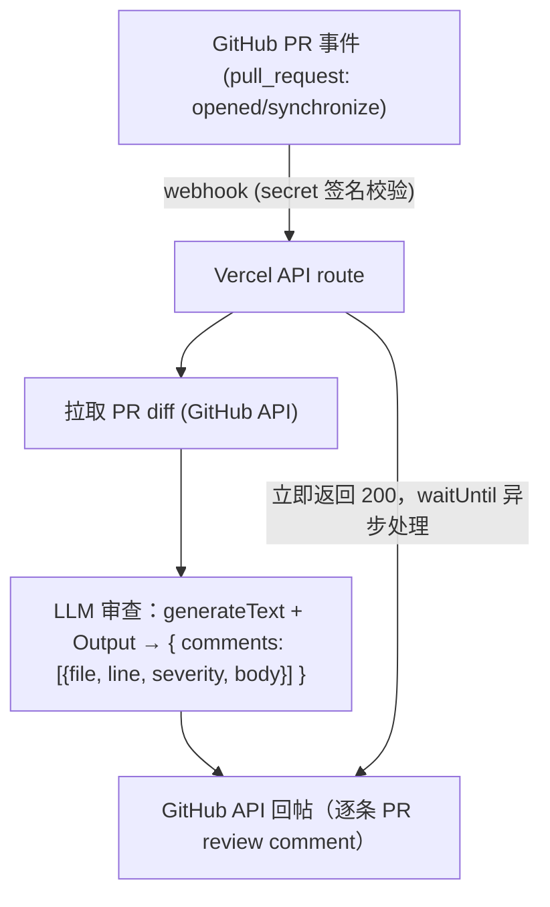

# PR Review Agent — 项目计划

> 一个带 eval 的 GitHub PR 审查 Agent。
> 本文件是项目总计划。新会话先读 `AGENTS.md`，按其指引再读本文档与 `docs/` 下的架构、决策、日志。
> 定位与选型是现行口径；执行步骤（第五节）与验收标准（第六节）是首周记录，已全部完成。**现状以 `docs/architecture.md` 为准**，活任务在 GitHub Issues（label `roadmap`）。

## 一、项目定位

**不是**"再写一个 code review 工具"，而是把三件最考验工程功底的事做扎实：

1. **Agent 工作流设计**：webhook 接收 PR 事件 → 拉 diff → 分层审查（结构化输出）→ 调 GitHub API 回帖
2. **评测意识**：一个 eval 集 + 回归脚本，改 prompt 后能拿出前后对比数据（改 prompt 不再盲改）
3. **真实工程集成**：GitHub webhook 签名校验、异步处理防超时重试、密钥管理

一句话项目描述：*"基于大模型的 PR 审查 Agent，webhook 架构部署在 Vercel，附一套自建 eval 集与 prompt 迭代对比报告。"*（用例构成见 README「eval」节）

## 二、技术选型（已确认）

| 项 | 选择 | 理由 |
|---|---|---|
| 运行时 | TypeScript + Node 22 | 前端背景零摩擦 |
| LLM 接入 | Vercel AI SDK + OpenAI 兼容端点 | TS 生态最主流的 LLM 接入框架；端点可插拔，当前接 GLM（key 现成） |
| 结构化输出 | AI SDK 的 `generateText` + `Output` / `streamObject` | 审查意见需要稳定 schema（`generateObject` 已废弃，见 decisions.md D009） |
| 部署 | Vercel Hobby（免费，100 万次调用/月，非商用） | 无状态 webhook 服务的标准形态，无需云服务器 |
| 模型计费 | OpenAI 兼容端点按 token（唯一实际成本） | 不用 Cursor SDK（绑订阅）/ Claude Agent SDK（无 key） |
| 项目组织 | 参考 Cursor Agent SDK 范式 | Markdown 放提示词、TS 函数定义工具、独立 evals 目录（"agent-as-code"） |

## 三、架构



关键工程细节（写进 README）：
- **先 200 再异步**：LLM 审查可能几十秒，超过 GitHub webhook 超时会触发重试导致重复评论 → 用 `waitUntil` 后台执行 + 幂等去重（同一 commit SHA 只审一次）。
- **diff 截断策略**：超大 PR 只取变更行附近上下文 / 按 file 分批调用。
- 提示词放 `prompts/*.md`，代码里只引用，方便迭代和 diff。

## 四、目录结构（顶层；模块级职责见 `docs/architecture.md` 组件表）

```
pr-review-agent/
├── AGENTS.md             # 本仓库的 Agent 工作规则
├── README.md             # 项目说明：效果读数、同类工具对照、环境变量
├── docs/                 # 架构 / 决策 / 开发日志 / 变更记录 / 部署说明；plans/ 是阶段性计划与调研归档
├── api/                  # Vercel function 入口：webhook、worker、runs；逻辑都在 src/
├── src/                  # 审查链路各模块（验签、阶段编排、审查、上下文、GitHub 发布、去重……）
├── prompts/              # 审查提示词：review.md 是迭代对象，其余按用途拆分
├── scripts/              # 本地工具：review-pr、resolve-threads、canary-patrol、aacr-bench、prodlogs
├── public/               # 运行观测面板的静态页
├── test/                 # 单测（npm test）
├── evals/                # cases/ 用例、run.ts 跑分、compare.ts 对比、report.md 报告、runs/ 落盘、prod-runs/ 生产台账
├── .github/workflows/    # review-threads（意见闭环 check）与 test（单测 + 类型检查）
└── vercel.json           # 函数超时、提示词打包、面板页安全头
```

## 五、执行步骤（约一周）

- [x] **Day 1**：`npm init` + Vercel AI SDK 接 OpenAI 兼容端点，跑通"输入 diff 文本 → 输出结构化审查意见"（核心链路，先本地 hardcode 一个 diff）
- [x] **Day 2**：`github.ts`（octokit 拉真 PR diff + 回帖），本地对任意公开仓库 PR 试跑
- [x] **Day 3**：webhook 路由 + 签名校验 + dedupe，部署 Vercel，在自己建的真实仓库上开 PR 全链路验证
- [x] **Day 4-5**：攒 eval 集（29 个用例：synthetic 20 + real 7 真实仓库 fix 反转与配对 + dogfood 2 回归集，D015 扩充）
- [x] **Day 6**：跑 eval → 改 2 轮 prompt（v2 定稿，v3 负结果回退）→ 出对比报告（`evals/report.md`：recall 92.6%→96.3%、precision 81.9%→94.2%，三轮微平均）
- [x] **Day 7**：README（含 eval 报告摘要与架构决策）；社交总结帖已代拟草稿（`docs/social-post-draft.md`），发布动作留用户执行

## 六、验收标准（首周口径，已全部达成）

现行的合并闸门见 `AGENTS.md`「合并闸门」，效果读数见 `evals/report.md`。

1. 真实仓库开 PR，机器人能在 1 分钟内留下结构化 review 评论
2. `npm run eval` 一条命令跑完 20 用例并输出打分表
3. eval 报告能展示至少一轮"prompt 改进 → 指标提升"
4. README 里讲清架构决策（异步/幂等/diff 截断）

## 七、核心设计问答（为什么这么做）

- 为什么 agent 需要 eval？（没有评测的 agent 迭代 = 盲改）
- webhook 为什么先回 200？（超时重试语义 + 幂等）
- 为什么结构化输出而不是自由文本？（下游可执行、可打分）
- 下一步路线：活任务在 GitHub Issues（label `roadmap`），不在这里维护
