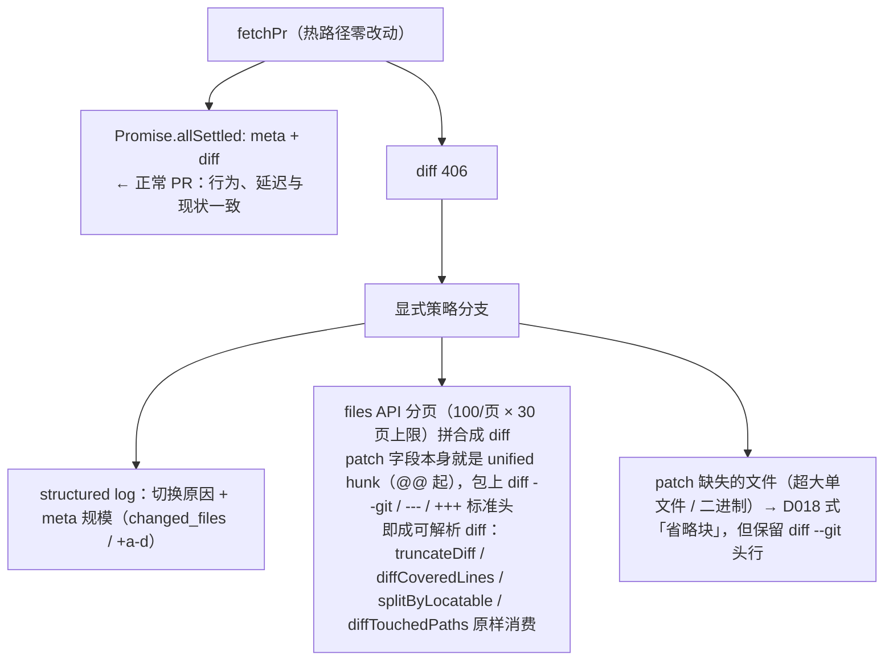

# Spec：超大 PR diff 拉取兜底——406 显式策略分支 + files 分页拼合

> 会话 25 dogfood 出的产品缺口（`GET /pulls/N` diff 形态 20,000 行硬上限 → 406 too_large，审查以「失败」告终且无法自愈）的修复。
> 2026-11-03 立项，决策记录见 `docs/decisions.md` D025。PR #26（注入 canary，并行会话）对 `docs/plans/PLAN.md` 的改动与本 spec 无冲突。

## 一、问题

`fetchPr` 用 diff 形态拉 PR diff。diff 总行数（含上下文）超 GitHub 硬上限 20,000 行时该请求 406——`runReview` 捕获后写 failure status，「审查失败，见 Vercel 日志」。lockfile 重生成、bulk 重命名、大批量生成物入库都能触发；D018 的 `DIFF_MAX_CHARS` 截断在此层**之前**，管不到。

## 二、方案（讨论定型的关键结论）

**「前置判断层」的形态由一个数学事实钉死**：自由元数据（meta 的 `changed_files` / `additions` / `deletions`）预判不了 406——406 的触发条件是含上下文行的 diff 总行数，而 context 放大系数取决于 hunk 散布程度（2k 行散布单行改动 ≈ 2k × 11 = 22k diff 行触发；15k 行连续改动 ≈ 15k 行不触发）。阈值松了照样 406、紧了误伤正常 PR。**可靠信号只有 406 本身（确定性失败）**。

因此：

**与 D023 的协同**：省略块保留路径头 → 路径仍进 `diffTouchedPaths` → zipball 上下文把该文件全文兜进 prompt。传输层拉不到的由上下文层补上，不留静默盲区。

**兼容性细节**：

- 删除文件发 `+++ /dev/null` → `diffCoveredLines` 对纯删除文件的既有语义（跳过，行内评论必 422）自动生效
- rename 用 `previous_filename` 作 a 侧；files API 的 patch 与真实 diff 的 hunk 逐字节一致 → 行内定位行号口径不变
- 超 3000 文件（files API 硬上限）→ 附「文件数超过 3000」省略行告知模型非全量
- 合成 diff 走既有管道：`DIFF_MAX_CHARS` 截断、上下文注入、行内定位全部无需感知来源

**明确不做**：

- LLM 决策层（Memdoor 式预处理路由）——D020 否决理由未变（非确定性撞 eval 回归与重审一致性、误判=静默漏审），路线图第 3 项另有前置
- 超大 PR 分发补审（拆两环节绕 300s）——D020 后果区记录的架构扩展，依赖异步化/预算拆分，不捆
- zip 解包自算 diff——需要 base+head 两份归档与 merge-base 逻辑，成本不成比例

## 三、验证

- 单测 +4（76 全绿）：四类 status 块可解析、patch 缺失省略块保路径、406 切分页（100+2 跨页）、30 页封顶省略行、非 406 透传、正常路径回归
- eval 零影响：`fetchPr` 不在 eval 路径（用例自包含 diff）
- 生产观测：406 切换时 `[fetchPr]` 日志行（触发频率 + 规模），此后超大 PR 不再以失败告终
- 真实验证手段有限：需要人为构造 >20k 行 diff 的 PR（如批量生成 run 文件）做一次端到端，可选
